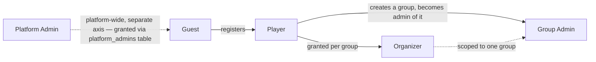

# Use Cases by Role

This document lists use cases per actor role, cross-checked against what is **actually implemented**
today (not just what the [PRD](../PRD.md) scopes for MVP V1). Each use case is tagged with its real
status so this doubles as an honest gap list — see [WORKFLOWS.md](./WORKFLOWS.md) for the technical
mechanics behind every ✅ item, and [ROADMAP.md](./ROADMAP.md) for the phased plan closing every ❌.

**Status legend**

| Icon | Meaning |
|---|---|
| ✅ | Implemented end-to-end (frontend + backend, verified working) |
| 🟡 | Partially implemented — works but with a caveat (see note) |
| ❌ | Not implemented — no route, no UI, or no data model for it yet |

## Role relationship

A single account can hold different roles in different groups (e.g. Group Admin of one club, plain
Player in another) — role is stored per `group_members` row, not on the account globally.
`group_member_role_enum` (`'Group Admin' | 'Organizer' | 'Player'`) is still inherently per-group and has
no platform-wide equivalent — Platform Admin is deliberately a separate table (`platform_admins`, Phase 6,
`migrations/0008_...`), not a value in that enum or a column on `profiles` (see `WORKFLOWS.md` §8 for why).
Every Platform Admin use case below now reflects what's actually implemented, not just conceptual scope.

---

## 1. Guest (unauthenticated visitor)

Per PRD §3, a Guest can browse public groups/events without an account, but cannot join or register.
Every group/event-mutating route still requires `requireAuth` and group membership — Phase 6 added a
dedicated, deliberately unauthenticated read-only surface (`backend/src/routes/public.routes.ts`,
`frontend/src/app/discover/*`) rather than opening up the existing member-scoped routes.

| ID | Use Case | Status | Note |
|---|---|---|---|
| UC-G1 | Browse public groups | ✅ | `GET /api/public/groups` (no auth) → `/discover`. Only `is_public = true AND suspended_at IS NULL` groups; `invite_code` never exposed |
| UC-G2 | View a public event's details | ✅ | Satisfied via the event fields (title/format/date/time/location/status/capacity) embedded in `GET /api/public/groups/:id`'s response, rather than a separate standalone public event-detail page — sufficient for browsing, no participant/registration data exposed |
| UC-G3 | Create an account | ✅ | See UC-P1 below — this is how a Guest becomes a Player |
| UC-G4 | Log in to an existing account | ✅ | `frontend/src/app/login/page.tsx` |
| UC-G5 | Reset a forgotten password | ✅ | `frontend/src/app/forgot-password/page.tsx` → `supabase.auth.resetPasswordForEmail()` → email link → `frontend/src/app/reset-password/page.tsx` → `supabase.auth.updateUser({password})`. Previously a dead `href="#"` link on the login page, not tracked as a use case at all despite PRD §4.1 listing it in MVP scope |

---

## 2. Player

**Precondition for all use cases below:** an authenticated Supabase session exists.

| ID | Use Case | Status | Note |
|---|---|---|---|
| UC-P1 | Register a new account | ✅ | `supabase.auth.signUp()`; profile auto-created by DB trigger |
| UC-P2 | Log out | ✅ | Clears session, redirects to `/` |
| UC-P3 | Edit profile (name, phone, skill level, gender) | ✅ | Direct Supabase write, RLS-gated to own row. `gender` (`migrations/0005_add_gender_field.sql`) is the newest field — nullable, self-declared, only ever consumed by the Mixed Partner format (UC-O2) |
| UC-P4 | Upload profile picture | ✅ | `avatars` Storage bucket created and RLS-scoped per user folder (`migrations/0009_...`), live-verified |
| UC-P5 | Join a group via invite link or code | ✅ | `/groups/join/:code` fetches a preview (`GET /join/:invite_code/preview`) and requires an explicit "Gabung" confirmation before `POST /api/groups/join/:invite_code` actually adds the member — no longer auto-joins on page load |
| UC-P6 | View list of groups joined | ✅ | Shows role per group; does **not** show groups not yet joined |
| UC-P7 | View a group's detail (members, its events) | ✅ | Requires membership; 403 otherwise |
| UC-P8 | View events in a joined group | ✅ | |
| UC-P9 | Register for an event | ✅ | Auto-placed on waiting list if the event is at capacity. **Phase 1 fix:** this previously had no group-membership check at all — any authenticated user who knew/guessed an event's UUID could register for a group they weren't a member of, a real multi-tenant isolation leak. Now gated by `requireGroupRole`. **Post-Phase-1 fix:** the capacity check and insert used to be two separate round-trips (a TOCTOU race — concurrent requests right at capacity could both land as `registered`, exceeding `max_players`); now done atomically inside a single locked Postgres transaction via the `register_for_event` DB function (`migrations/0002_atomic_event_registration.sql`). **Mixed Partner events specifically** also require `profiles.gender` to be set first — registration is rejected with a 400 pointing at the profile page otherwise |
| UC-P10 | See own waiting-list position | ✅ | `waiting_list_position` computed server-side (`attachWaitingListPosition()`, `backend/src/routes/events.routes.ts`) and attached to every registration in `GET /:id`, withdraw, and promote responses — frontend just reads the field |
| UC-P11 | Withdraw registration from an event | ✅ | `POST /api/events/:id/withdraw` — self-service only. If the withdrawing player was `registered` (not `waiting_list`) and it's still before the promotion cutoff (registration deadline / event start, whichever is earlier), the earliest waitlisted player is auto-promoted atomically. A promotion after a static-format schedule already exists doesn't retroactively add the player to any match (Mexicano is unaffected by this since it regenerates each round from live registration state) |
| UC-P12 | View the live match schedule for an event | ✅ | UI fully works, and an Organizer can now generate real matches for **all 5 formats** (UC-O2) |
| UC-P13 | Self-report a match score | ✅ | Either player on the match can do this; blocked once a score is `pending_confirmation` |
| UC-P14 | Confirm an opponent-reported score | ✅ | Only the designated `needs_confirm_by` player can act |
| UC-P15 | Dispute an opponent-reported score | ✅ | Wipes the score, match reopens for re-entry by either player |
| UC-P16 | View live leaderboard during an event | ✅ | Real-time via Socket.IO; also computed correctly on initial page load |
| UC-P17 | View match history / personal stats after an event | ✅ | `GET /api/players/me/stats` — computed on-the-fly from confirmed `matches` across every group the player has ever played in (self-scoped, no persisted stats table). Quick summary (wins, points) on the Dashboard; full match-by-match history table on the Profile page |

---

## 3. Organizer (role scoped to one group)

**Precondition:** authenticated, and holds `role = 'Organizer'` (or `'Group Admin'`) in the target
group's `group_members` row — enforced server-side on every write, not just hidden client-side.

| ID | Use Case | Status | Note |
|---|---|---|---|
| UC-O1 | Create an event (pick format, date, courts, quota) | ✅ | All 5 formats accepted as a label, and all 5 are now actually schedulable (UC-O2) |
| UC-O2 | Close registration and generate the match schedule | ✅ | `POST /api/events/:id/generate-schedule` handles the first generation for every format: Americano/Round Robin/Fixed Partner (one-time, no regenerate), Mexicano (round 1 only — later rounds use a separate repeatable `POST /api/events/:id/generate-next-round`, gated on every existing match being confirmed, since pairing is standings-driven), and Mixed Partner (gender-balanced teams via `formMixedTeamsByRegistrationOrder`, otherwise identical mechanics to Fixed Partner — hard-rejects with 400 if the registered Male/Female counts don't match, unlike Fixed Partner's warn-and-exclude for an odd player out) |
| UC-O3 | Auto-assign courts per round | ✅ | Handled by the same generate-schedule/generate-next-round endpoints for all 5 formats — `packIntoPhysicalRounds()` never exceeds `courts_count` matches per round |
| UC-O4 | View who's registered / waiting for an event | ✅ | Dedicated "Peserta" tab on the live match page (Organizer/Group Admin only) listing name, skill level, status, and registration time, with a quota summary. Previously marked ✅ on API-availability alone with no actual UI — corrected |
| UC-O5 | Manually promote a waiting-list player | ✅ | `POST /api/events/:id/registrations/:registrationId/promote` — Organizer/Group Admin only, promotes a SPECIFIC waitlisted registration (not necessarily the earliest, unlike withdraw's auto-promotion), rejected with 409 if the event is already at `max_players` (no capacity override) |
| UC-O6 | Enter or correct a match score directly (override) | ✅ | `PATCH /api/matches/:id/override` — Organizer/Group Admin only, sets the score directly to `confirmed` with no player confirmation step, broadcasts live like a normal confirm |
| UC-O7 | Change event status (Draft → Open → Full → In Progress → Completed → Cancelled) | ✅ | `PATCH /api/events/:id/status` — Organizer/Group Admin only, enforces a fixed transition map server-side (e.g. `Open` can't jump straight to `Completed`); `Completed`/`Cancelled` are terminal |
| UC-O8 | Everything a Player can do (register for other events, report own scores, etc.) | ✅ | Organizer is additive, not a separate account type |

---

## 4. Group Admin (owns a group)

**Precondition:** authenticated, holds `role = 'Group Admin'` in the target group.

| ID | Use Case | Status | Note |
|---|---|---|---|
| UC-GA1 | Create a group (public or private) | ✅ | Creator is automatically set as `Group Admin` |
| UC-GA2 | Share invite link | ✅ | Real `invite_code`-based URL, functional end-to-end |
| UC-GA3 | Share invite QR code | ✅ | Real scannable QR (`qrcode.react`'s `QRCodeSVG`, fully client-side, no external network call) encoding the actual invite URL |
| UC-GA4 | View group members and their roles | ✅ | |
| UC-GA5 | Promote a Player to Organizer | ✅ | `PATCH /api/groups/:id/members/:userId` — only accepts `'Player'`/`'Organizer'` (not `'Group Admin'`, ownership isn't transferable through this route); a caller can't change their own role |
| UC-GA6 | Demote an Organizer back to Player | ✅ | Same endpoint as UC-GA5 |
| UC-GA7 | Remove a member from the group | ✅ | `DELETE /api/groups/:id/members/:userId`; the group's owner (`groups.created_by`) can't be removed through this route — there's no ownership-transfer flow yet, so removing the owner would orphan the group |
| UC-GA8 | Edit group settings (name, description, public/private) | ✅ | `PATCH /api/groups/:id` |
| UC-GA9 | Everything an Organizer can do within their own group | ✅ | Group Admin is a superset of Organizer in every route's role check (`role IN ('Organizer', 'Group Admin')`) |

---

## 5. Platform Admin

**Precondition:** a row in `platform_admins` (`migrations/0008_platform_admin_and_group_suspension.sql`)
for the caller's user id — grantable only via a manual SQL `INSERT`, no self-service or API path exists.
Scoped deliberately minimally per `ROADMAP.md` Phase 6 ("not a full permission system"): view-only for
groups/users, plus suspend/unsuspend a group. No content editing, no override of Group Admin decisions
beyond that.

| ID | Use Case | Status | Note |
|---|---|---|---|
| UC-PA1 | View/manage all groups on the platform | 🟡 | `GET /api/admin/groups` → `/admin`. "View" fully works; "manage" is limited to suspend/unsuspend — no edit/delete of a group's content |
| UC-PA2 | View/manage all users on the platform | 🟡 | `GET /api/admin/users` (merges `auth.users` + `profiles`) → `/admin`. View works; no manage/ban/edit action exists |
| UC-PA3 | Moderate disputes between Group Admin and members | ❌ | PRD §7 lists this boundary as an explicit open design question, still unresolved — untouched by Phase 6 |
| UC-PA4 | Suspend or remove a group | 🟡 | `PATCH /api/admin/groups/:id/suspend`/`/unsuspend` — fully locks out the group for everyone (see `WORKFLOWS.md` §8) without deleting any data; hard-delete/removal is explicitly out of scope |
| UC-PA5 | Configure platform-wide settings | ❌ | Not implemented, not scoped for Phase 6 |
