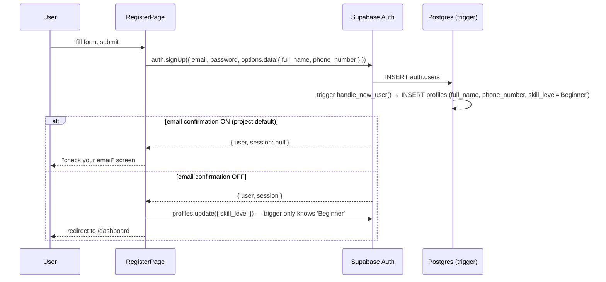
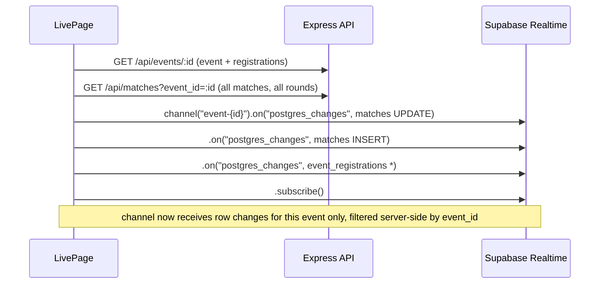

# Application Workflows

This document explains, function by function, how each working feature of Rally Hub
actually moves data between the three layers: **Next.js frontend** (`frontend/`), **Express backend**
(`backend/`), and **Supabase** (Postgres + Auth + Storage). It reflects the code as of Phase 6 plus the
post-Phase-6 join-confirmation addendum — see [ROADMAP.md](./ROADMAP.md) for the phased plan (Phase 7,
hardening, is the only remaining phase; WhatsApp integration was descoped, not deferred).

Two different data paths exist side by side, and it matters which one a given feature uses:

- **Frontend → Express API → `supabaseAdmin`** (service-role key, bypasses RLS) — used for Groups,
  Events, and Matches. The Express layer is where membership/role checks are enforced.
- **Frontend → Supabase directly** (anon key, RLS-enforced) — used for Auth, Profile, and Storage.
  No Express route exists for these; authorization is enforced entirely by Postgres RLS policies in
  [`schema.sql`](../schema.sql).

Every Express call from the frontend goes through one helper, so it's worth knowing first:

```
frontend/src/lib/api.ts — apiFetch(path, options)
```
1. Reads the current Supabase session via `supabase.auth.getSession()`.
2. Attaches `Authorization: Bearer <access_token>` if a session exists.
3. Calls `${NEXT_PUBLIC_API_URL}${path}` (defaults to `http://localhost:3001`).
4. Parses the JSON body; throws `ApiError(message, status, body)` on a non-2xx response.

Every protected Express route starts with `requireAuth` (`backend/src/middlewares/auth.middleware.ts`),
which validates that bearer token against Supabase (`supabaseAdmin.auth.getUser(token)`) and attaches
`req.user = { id, email }`.

Group/role authorization is a second, composable middleware: `requireGroupRole(allowedRoles,
resolveGroupId)` (`backend/src/middlewares/rbac.middleware.ts`). It looks up the caller's
`group_members` row for a group id resolved by the second argument and 403s if their role isn't in
`allowedRoles`. The resolver is what varies per route — `groupIdFromParam`, `groupIdFromQuery`,
`groupIdFromBody`, `groupIdFromEventParam`/`groupIdFromEventQuery` (look up an event, then its
`group_id`), and `groupIdFromMatchParam` (look up a match → its event → that event's group) cover every
shape a group id shows up in across the API. This replaced a pattern where every route hand-rolled the
same `group_members` select-and-check — see each workflow below for which resolver a given endpoint
uses.

---

## 1. Authentication

### 1.1 Register

**Files:** `frontend/src/app/register/page.tsx`, `frontend/src/lib/supabase/client.ts`, `schema.sql`
(`handle_new_user` trigger)



**Why the extra `profiles.update` after signup:** the `handle_new_user()` Postgres trigger
(`schema.sql:59-71`) only reads `full_name` and `phone_number` out of the signup metadata — it always
defaults `skill_level` to `'Beginner'`. The form's actual skill-level selection is applied client-side
right after signup, and **only if a session came back immediately** (i.e. email confirmation is off).
If confirmation is required, the skill level silently stays `'Beginner'` until the user edits their
profile after confirming — this is a known gap, not a bug to "fix" without changing the trigger.

### 1.2 Login

**Files:** `frontend/src/app/login/page.tsx`

Straightforward: `supabase.auth.signInWithPassword({ email, password })` → on success, redirect to
`?next=` (if middleware bounced the user here) or `/dashboard`. `router.refresh()` forces Server
Components to re-read the new session cookie.

### 1.3 Session persistence & route protection

**Files:** `frontend/src/middleware.ts`, `frontend/src/lib/middleware.ts`,
`frontend/src/components/providers/auth-provider.tsx`

Two independent mechanisms exist and don't talk to each other — know which one is doing the work:

1. **Edge middleware** (`frontend/src/middleware.ts`, matcher: `/dashboard/*`, `/profile/*`,
   `/groups/create`, `/events/create`) runs on the server before the page renders. It calls
   `updateSession()`, which refreshes the Supabase cookie session and — critically — **redirects
   unauthenticated requests to `/login?next=<path>`** before any React code runs. Note the file
   *must* live under `src/` (not the project root) because the project uses `src/app` — this bit us
   once already; Next silently no-ops a root-level `middleware.ts` in that layout.
2. **`AuthProvider`** (client-side React context, wraps the whole app in `layout.tsx`) calls
   `supabase.auth.getSession()` on mount and subscribes to `onAuthStateChange`. It exposes
   `{ user, session, loading, signOut }` via `useAuth()`. Every data-fetching page (`groups`, `events`,
   dashboard, live match, etc.) uses this to decide what to render *client-side* — e.g. showing a
   "log in to continue" state — for routes middleware doesn't cover (like `/groups`, `/events`, which
   are intentionally left open at the edge but still require a session to actually fetch anything, so
   the page itself gates on `useAuth()`).

### 1.4 Sign out

**Files:** `frontend/src/components/layout/navbar.tsx`, `auth-provider.tsx`

`useAuth().signOut()` → `supabase.auth.signOut()` clears the session cookie → navbar pushes to `/` and
`router.refresh()`.

### 1.5 Forgot / reset password

**Files:** `frontend/src/app/forgot-password/page.tsx`, `frontend/src/app/reset-password/page.tsx`,
`auth-provider.tsx`

Two-page flow, entirely client-side Supabase Auth calls — no Express route, no `/auth/callback` route
(none exists anywhere in the app):

1. `/forgot-password`: user submits email → `supabase.auth.resetPasswordForEmail(email, { redirectTo:
   '<origin>/reset-password' })`. Always shows the same "check your email" success state regardless of
   whether the email is actually registered, to avoid leaking account existence to an anonymous caller —
   Supabase itself doesn't error on an unregistered email either.
2. Supabase emails a recovery link pointing at `/reset-password`. Clicking it lands the browser there
   with a recovery token; the Supabase JS SDK picks this up automatically and fires a `PASSWORD_RECOVERY`
   auth state change, which `AuthProvider`'s existing `onAuthStateChange` subscription (§1.3) already
   catches — no new listener needed, `useAuth().user` just becomes populated with a transient recovery
   session.
3. `/reset-password` gates purely on `useAuth()`: `loading` → spinner; `!user` (link invalid/expired) →
   error state with a link back to `/forgot-password`; `user` present → password + confirm-password form
   → `supabase.auth.updateUser({ password })` → redirect to `/dashboard` (the recovery session is already
   a valid session, same as a normal login).

Previously this was a dead `href="#"` link on the login page — not tracked in `USE_CASES.md` at all
despite PRD §4.1 listing "Forgot Password" as in-scope for MVP V1. Now `login/page.tsx`'s "Lupa Password?"
link points at `/forgot-password`.

---

## 2. Groups

### 2.1 Create group

**Files:** `frontend/src/app/groups/create/page.tsx` → `POST /api/groups`
(`backend/src/routes/groups.routes.ts:26-68`)

1. Frontend `apiFetch('/api/groups', { method: 'POST', body: { name, description, is_public } })`.
2. Backend validates the body with a Zod schema, then does **two writes**: `INSERT groups` (with
   `created_by = req.user.id`), then `INSERT group_members` with `role = 'Group Admin'` for that same
   user. Both use `supabaseAdmin`, so this is not an atomic transaction — if the second insert fails,
   you get an orphaned group with no admin. Acceptable for now, worth revisiting if it ever happens in
   practice.
3. Frontend redirects to `/groups/:id` using the returned group id.

### 2.2 List my groups

**Files:** `frontend/src/app/groups/page.tsx` → `GET /api/groups` (`groups.routes.ts:10-24`)

Returns only groups the caller is a member of — `group_members` joined to `groups`, filtered by
`user_id = req.user.id` — this page is "my groups," not a directory (see §7 for the actual public
directory, `GET /api/public/groups`, added in Phase 6). An unauthenticated hit shows a "log in" prompt
instead of calling the API. The select embeds `suspended_at` (Phase 6) so a member sees a "Disuspend"
badge on a group a Platform Admin has suspended, rather than it silently disappearing.

### 2.3 Group detail

**Files:** `frontend/src/app/groups/[id]/page.tsx` → `GET /api/groups/:id`
(`groups.routes.ts:71-104`) + `GET /api/events?group_id=:id` (fetched in parallel)

1. Backend first checks the caller is a member (`group_members` lookup) — 403 if not, before ever
   querying the group. This is deliberate: it prevents a private group's name/description leaking to
   non-members via a 404-vs-403 timing/response difference.
2. On success it returns the group plus a nested `group_members(role, user_id, profiles(...))` array —
   this is what populates the "Anggota" (Members) panel.
3. The frontend derives the caller's own role from that array (`group_members.find(m => m.user_id ===
   user.id)`) to decide whether to show the "Buat Event" button (only Organizer/Group Admin).
4. The invite link shown (`Salin Link`) points at `/groups/join/:invite_code` — see 2.4. The "QR Code
   Undangan" modal renders a real, scannable QR via `qrcode.react`'s `QRCodeSVG` component encoding that
   same URL — fully client-side, no external network call — replacing what used to be a hardcoded
   decorative `<svg>` that didn't encode anything at all.

### 2.4 Join a group via invite link/code

**Files:** `frontend/src/app/groups/join/[code]/page.tsx` →
`GET /api/groups/join/:invite_code/preview` then `POST /api/groups/join/:invite_code`
(both `groups.routes.ts`)

1. Page reads the `:code` param, waits for auth to resolve; if no session, shows a "log in first" state
   with `?next=` pointing back at the same join URL so the redirect chain completes after login.
2. Once authenticated, it calls the **preview endpoint** first (`requireAuth` only, no
   `requireGroupRole` — the caller isn't a member yet). This looks up the group by `invite_code` and
   returns `{ id, name, description, suspended_at, member_count, already_member }` — `invite_code` itself
   is never echoed back. A `group_members` existence check against the caller's own `user_id` produces
   `already_member`; the group isn't hard-403'd for being suspended, `suspended_at` is just passed through
   so the frontend can render an inline state.
3. **This is where the join-confirmation step lives** (added post-Phase 6): the page renders a card with
   the group's name/description/member count and a "Gabung" button — it no longer auto-joins on page
   load. If `already_member` is true, the button is replaced with an "Anda sudah menjadi anggota" message
   and a link straight to `/groups/:id`. If `suspended_at` is set, it's replaced with a suspended message
   and no button at all. Only clicking "Gabung" fires the actual join.
4. Clicking "Gabung" calls the **existing, unchanged** `POST /api/groups/join/:invite_code` — looks up the
   group again, then `INSERT group_members` with `role = 'Player'`. A `23505` (unique violation) means
   "already a member" → 409 with a friendly message (a defensive fallback; the preview step should already
   have caught this case). The suspended-group gate from Phase 6 is unchanged — see point 5 below.
5. On success, the frontend now redirects straight to `/groups/:id` (the id is already in hand from the
   preview response) instead of the generic `/groups` list it fell back to before this step existed.
6. **Suspended-group gate (Phase 6, unchanged):** the POST endpoint doesn't run through `requireGroupRole`
   (the caller isn't a member yet), so it has its own inline `suspended_at` check — 403 if the group is
   currently suspended, before the `group_members` insert. See §8 for the general suspension mechanism.
   The preview step in point 2 surfaces this same condition earlier, but the POST still re-checks it
   independently — a group could theoretically be suspended in the gap between the two calls.

### 2.5 Edit group settings

**Files:** `frontend/src/app/groups/[id]/page.tsx` (Edit Grup modal) → `PATCH /api/groups/:id`
(`groups.routes.ts`, `requireGroupRole(GROUP_ADMIN_ONLY, groupIdFromParam('id'))`)

Group Admin only. Body is a partial `{ name?, description?, is_public? }`, validated to require at least
one field. On success the frontend merges the response into local `group` state rather than refetching.

### 2.6 Member role management (promote / demote / remove)

**Files:** `frontend/src/app/groups/[id]/page.tsx` (member row buttons) →
`PATCH /api/groups/:id/members/:userId` and `DELETE /api/groups/:id/members/:userId`
(both `requireGroupRole(GROUP_ADMIN_ONLY, groupIdFromParam('id'))`)

1. **Role change** only accepts `'Player'` or `'Organizer'` in the body — there's no way to grant or
   revoke `'Group Admin'` through this endpoint, so group ownership can't be transferred this way yet.
2. Both endpoints independently guard the group's owner (`groups.created_by`): their role can't be
   changed and they can't be removed, because nothing yet reassigns ownership — doing either would leave
   the group without an admin. The role-change endpoint also blocks a caller from changing their *own*
   role, to avoid accidental self-lockout.
3. The frontend hides both action buttons entirely (not just disables them) for the owner's row and the
   caller's own row, so a Group Admin only ever sees them on other members.
4. **RLS note:** `schema.sql` originally defined no `UPDATE` policy for `group_members` (only `INSERT` and
   `DELETE`) — `migrations/0001_group_members_update_policy.sql` (applied 2026-08-10) added one for
   defense-in-depth, since the role-change endpoint itself runs through `supabaseAdmin` and never needed
   RLS to permit it.
5. **RLS recursion bug, fixed:** all four `group_members` policies (the three in `schema.sql` plus 0001's
   `UPDATE` one) originally checked "am I a member/admin of this group?" by subquerying `group_members`
   from *within* a policy defined *on* `group_members` — a self-reference that makes Postgres raise
   `infinite recursion detected in policy for relation "group_members"`. This was latent from day one
   because nearly every read in this app goes through `supabaseAdmin` (bypasses RLS) — the *only* path
   that ever exercised it was the Profile page (§5), which talks to Supabase directly with the anon key.
   Its `profiles` fetch hits the `profiles: read group members` policy, which subqueries `group_members`
   — the first real RLS read of that table anywhere in the app. Fixed by
   `migrations/0007_fix_group_members_rls_recursion.sql`: the membership/admin check now goes through two
   `SECURITY DEFINER` functions (`is_group_member`, `is_group_admin`) whose internal query bypasses RLS
   (table owners are exempt from their own tables' RLS by default), breaking the cycle instead of
   re-triggering the very policy being evaluated. No other policy needed changing — once `group_members`'
   own policies stop self-recursing, every other table's subquery into it (`profiles`, `groups`, `events`,
   `event_registrations`, `matches`) resolves normally.

---

## 3. Events

### 3.1 Create event

**Files:** `frontend/src/app/events/create/page.tsx` → `POST /api/events`
(`backend/src/routes/events.routes.ts:46-97`)

1. On mount, the page fetches `/api/groups` and filters client-side to groups where the caller's role
   is `Organizer` or `Group Admin` — this mirrors (but does not replace) the backend's own check, so the
   user sees *why* the group selector might be empty instead of hitting a 403 blind.
2. Submits `{ group_id, title, format, event_date, start_time, location, courts_count, max_players }`
   (description and registration_deadline are optional and currently not exposed in the form).
3. Backend re-validates the same Zod schema, re-checks membership + role server-side (never trusts the
   client-side filter), then inserts with `status` defaulting to `'Draft'`.
4. Frontend redirects to `/events/:id/live`. **Note:** a freshly created event has `status = 'Draft'` and
   zero matches. The Organizer can now move it to `Open` (see §3.4) so players can register, then click
   "Generate Schedule" (see §3.6) once enough players are in — for Americano, Round Robin, or Fixed
   Partner. Mexicano and Mixed Partner events still have no way to generate matches (Phase 2b) — the live
   page's empty state (see §4.1) is what everyone sees until then.

### 3.2 List events

**Files:** `frontend/src/app/events/page.tsx` and `frontend/src/app/dashboard/page.tsx` →
`GET /api/events?group_id=` (`events.routes.ts:8-44`), called once per joined group

There is no "all events across my groups" endpoint. Both pages that need a merged list do it
client-side: fetch `/api/groups`, then `Promise.all` a `/api/events?group_id=` call per group, then
flatten + sort by `event_date`. This is fine at small scale (a handful of groups) but is an N+1 pattern
that would need a real aggregate endpoint if a user joins many groups.

### 3.3 Event detail, registration, and the waiting list

**Files:** `frontend/src/app/events/[id]/live/page.tsx` → `GET /api/events/:id`
(`events.routes.ts:101-135`) and `POST /api/events/:id/register` (`events.routes.ts:139-190`)

1. `GET /api/events/:id` returns the event plus a `registrations` array of
   `{ status, registered_at, profiles }`. **Gotcha #1:** when an event has zero registrations, Supabase
   returns `registrations: null`, not `[]` — the frontend normalizes this immediately after fetch
   (`registrations: eventRes.data.registrations ?? []`) because several `.find()`/`.filter()` calls
   downstream assume an array.
   **Gotcha #2 (was a real bug, now fixed):** `event_registrations` has *two* foreign keys into
   `profiles` — `user_id` and `partner_user_id` (for Fixed/Mixed Partner formats). An unqualified
   `profiles(...)` embed is ambiguous, and PostgREST errors on it rather than guessing. The original code
   only destructured `{ data }` from that query and never checked `error`, so the ambiguous-embed error
   was silently swallowed and `registrations` came back `null` **even when rows existed** — a player
   could register successfully (the insert has no embed, so it worked fine), but the event detail fetch
   right after would never show them as registered, no matter how many times the page was reloaded. Fixed
   by qualifying the embed — `profiles!event_registrations_user_id_fkey(...)` — the same disambiguation
   pattern `matches.routes.ts` already needed for its four player columns, plus checking that query's
   `error` and 500ing instead of silently returning bad data.
2. The register button only renders if `event.status === 'Open'` and the caller has no existing
   registration row for this event.
3. On submit, the backend calls the `register_for_event(p_event_id, p_user_id)` Postgres function
   (`migrations/0002_atomic_event_registration.sql`) via `supabaseAdmin.rpc(...)`, instead of doing the
   count-then-insert itself. The function counts existing `status = 'registered'` rows and compares to
   `max_players` inside one transaction: under quota → `status: 'registered'`; at/over quota →
   `status: 'waiting_list'`. A `23505` conflict on the underlying unique `(event_id, user_id)` still means
   "already registered" → 409.
   **Gotcha #3 (was a real bug, now fixed):** the original implementation did the count and the insert as
   two separate round-trips from the route handler. Two concurrent registration requests arriving right at
   capacity could both read the same "not full yet" count before either insert landed, and both get
   `status: 'registered'` — pushing the event over `max_players` (a TOCTOU race). `register_for_event`
   fixes this by locking the event row (`SELECT ... FOR UPDATE`) before counting, so a second concurrent
   call blocks until the first commits and sees its effect.
4. The frontend computes the caller's **waiting-list position** itself (backend doesn't return a rank):
   filter registrations to `waiting_list`, sort by `registered_at`, find the caller's index + 1.
5. **Withdrawal and auto-promotion** are now implemented — see §3.9 below.
6. **Mixed Partner gate:** before calling `register_for_event`, the handler now fetches the event's
   `format`; if it's `'Mixed Partner'`, it also fetches the caller's own `profiles.gender` and rejects
   with 400 if unset — "complete your profile first." Every other format skips this check entirely (no
   extra query cost for the common case). See §5 (Profile) and §3.8 (Mixed Partner scheduling).

**Security note:** until Phase 1, step 1 above (and the register endpoint) had **no group-membership
check at all** — any authenticated user who knew or guessed an event's UUID could register for a group
they weren't a member of. That's now closed the same way every other route in this section is:
`requireGroupRole(ANY_GROUP_MEMBER, groupIdFromEventParam('id'))` runs before the handler.

### 3.4 Event status transitions

**Files:** `frontend/src/app/events/[id]/live/page.tsx` (Kontrol Organizer panel) →
`PATCH /api/events/:id/status` (`events.routes.ts`, `requireGroupRole(ORGANIZER_OR_ADMIN,
groupIdFromEventParam('id'))`)

1. Organizer/Group Admin only. Body is `{ status }`, one of the six `event_status_enum` values.
2. The backend enforces a fixed transition map (`ALLOWED_TRANSITIONS`) server-side — e.g. `Draft` can
   only go to `Open` or `Cancelled`; `Open` can go to `Full`/`In Progress`/`Cancelled` but **not**
   straight to `Completed`; `Completed` and `Cancelled` are terminal (no outbound transitions at all). An
   invalid request gets a 400 with the actual allowed list in the response body, not just a generic
   rejection.
3. The frontend mirrors the same map client-side purely to decide which buttons to render — the backend
   re-validates regardless, so this duplication is UX-only, not a trust boundary.
4. This is what actually unblocks event registration (§3.3) in practice: every event is created in
   `Draft`, and the register endpoint requires `status === 'Open'` — before this endpoint existed, no
   event could ever be registered for through the API at all.

### 3.5 View registered participants (Organizer / Group Admin)

**Files:** `frontend/src/app/events/[id]/live/page.tsx` ("Peserta (N)" tab) — no new endpoint, reuses
`GET /api/events/:id`'s existing `registrations` array (§3.3).

The backend has returned full registration + profile data since before Phase 1 — what was missing was
any frontend surface for it. The live match page's `registrations` array was only ever used internally
(to compute the *caller's own* registration status and waiting-list position); nothing rendered the full
list. Now, a third tab next to Pertandingan/Klasemen — visible only when `isOrganizerOrAdmin` — lists
every registration sorted `registered` first then `waiting_list` (each group by `registered_at`), showing
name, self-declared skill level, status badge, and registration timestamp, plus a quota summary
(`registered.length / max_players`, and a waiting-list count if any). This is purely a read view — no new
authorization surface, since anyone who can already load the event detail already receives this data; the
tab just decides who gets a UI for it. This was previously counted ✅ in `USE_CASES.md` (UC-O4) on the
strength of the API alone — a reminder that "the data is returned" and "there's a UI for it" aren't the
same claim.

Each `waiting_list` row also carries its rank (`waiting_list_position`, e.g. "Daftar Tunggu (#2)"),
computed server-side (see below), and — new — a **"Promosikan"** button per `waiting_list` row, calling
`POST /api/events/:id/registrations/:registrationId/promote`. Unlike withdraw's automatic promotion
(§3.9, always the earliest by `registered_at`), this lets the organizer pick a *specific* waitlisted
player out of order (e.g. for skill balance). Direct click, no confirmation modal — this tab is already
organizer-only and the action is trivially reversible (withdraw the player again). The backend
(`promote_registration`, `migrations/0010_manual_registration_promotion.sql`) mirrors
`withdraw_from_event`'s locking convention (lock the `events` row `FOR UPDATE` first) and **enforces
capacity with no override** — 409 `EVENT_FULL` if `registered` count already equals `max_players`. On
success it broadcasts `registrations:updated` with the same shape withdraw already uses, so the existing
socket listener (§3.9) picks it up with zero frontend changes beyond the button itself.

**Waiting-list position is now server-computed**, not derived client-side: `attachWaitingListPosition()`
(`backend/src/routes/events.routes.ts`) ranks every `waiting_list` registration by `registered_at`
(1-indexed, `null` for `registered`/`withdrawn` rows) and is applied everywhere `REGISTRATION_SELECT`'s
result is returned — `GET /:id`, withdraw, and promote. The frontend's own `waitingListPosition` memo
was removed; it just reads `registration.waiting_list_position` directly now, so there's a single
source of truth for ordering instead of two independent sorts that could theoretically disagree.

### 3.6 Generate match schedule (Phase 2a)

**Files:** `frontend/src/app/events/[id]/live/page.tsx` ("Generate Schedule" button in the Kontrol
Organizer panel) → `POST /api/events/:id/generate-schedule` (`backend/src/routes/schedule.routes.ts`,
`requireGroupRole(ORGANIZER_OR_ADMIN, groupIdFromEventParam('id'))`) → `backend/src/services/scheduling/`

Closes the single largest gap called out at the top of this document: an event created before this phase
never got `matches` rows on its own. Supports the 3 **static** formats — Americano, Round Robin, Fixed
Partner — that can be computed once, upfront, from the final registered-player list. Mexicano and Mixed
Partner (standings-dependent / gender-constrained) remain unimplemented, deliberately deferred to Phase 2b.

1. **Team formation.** Fixed Partner and Round Robin both need players grouped into fixed 2-person teams
   before scheduling can run. There is still no partner-selection UI anywhere in the app
   (`event_registrations.partner_user_id` remains unused) — teams are auto-formed by
   `formTeamsByRegistrationOrder()` by pairing consecutive registrants (`registered_at` ASC: 1st+2nd,
   3rd+4th, ...). An odd player out (the most recently registered) is excluded from the schedule; the
   response's `warning` field surfaces this rather than silently dropping them.
2. **Algorithm** (`backend/src/services/scheduling/`, all pure functions, no Supabase import — unit-tested
   in isolation via Vitest):
   - `roundRobin.ts` — the textbook "circle method": fix one entity, rotate the rest one position per
     round, pair symmetric positions. `circleMethodPairs(n)` produces a full round-robin schedule for `n`
     entities, padding with a bye slot if `n` is odd.
   - **Round Robin** (`roundRobinFormat.ts`) uses `circleMethodPairs` directly on the formed teams,
     **uncapped** — "every team plays every other team exactly once" is the format's defining property
     (PRD), so all `teams.length - 1` (or `teams.length` if odd) rounds run regardless of how large that is.
   - **Fixed Partner** (`fixedPartnerFormat.ts`) uses the same `circleMethodPairs` schedule but **clamped**
     to `clamp(teams.length - 1, 3, 8)` rounds — PRD only requires "opponents rotate," not full completion.
   - **Americano** (`americano.ts`) does *not* reuse `circleMethodPairs` — grouping individuals into fours
     with an internal team-split choice is a different-shaped problem. It only reuses the low-level
     `rotateCircle()` index permutation to get a fresh ordering of that round's active players, sits out
     `n % 4` players per round (lowest bye-count first, for fairness), chunks the rest into groups of 4,
     and for each group greedily picks whichever of the 3 possible team-splits least repeats a past
     partnership (tracked via `partnerCount`/`opponentCount` maps). Rounds are clamped the same way as
     Fixed Partner.
   - `packer.ts` flattens each "logical round" into physical `round_number`/`court_number` rows, splitting
     a round with more matchups than `courts_count` into consecutive physical rounds so no court ever hosts
     two matches at once. `round_number` increments monotonically across the whole event, not per logical
     round.
   - `index.ts` is the single dispatcher (`generateSchedule(format, playerIds, courtsCount)`) — rejects
     Mexicano/Mixed Partner with `SchedulingError('UNSUPPORTED_FORMAT')` rather than silently
     mis-scheduling them.
3. **Endpoint preconditions**, in order: event must exist (404), `status` must be `Open`/`Full`/`In
   Progress` (400 otherwise — Draft is too early, Completed/Cancelled are terminal), at least 4
   `registered`-status players (400 otherwise). No regeneration: if any `matches` row already exists for
   the event, the request is rejected — **409**.
4. **Atomicity.** The route computes the match rows in Node, then calls the
   `generate_event_schedule(p_event_id, p_matches)` Postgres function
   (`migrations/0003_atomic_schedule_generation.sql`) via `supabaseAdmin.rpc(...)`. That function locks the
   event row (`SELECT ... FOR UPDATE`), re-checks that no `matches` exist, and bulk-inserts — closing the
   same TOCTOU race class already fixed for registration in migration 0002 (two near-simultaneous clicks,
   or two co-organizer tabs, can't both pass the "no schedule yet" check and both insert).
5. **Response & real-time propagation.** `201 { data, warning? }` — `data` is the newly inserted matches
   with player names embedded (same shape as `GET /api/matches`). `warning` is set when a player was
   excluded for team formation, or when the computed round count exceeds 12 (a large Round Robin can
   legitimately need many rounds — courts_count vs. player count is left to the organizer's judgment, not
   validated). The route doesn't push this payload anywhere itself — `matches` is in the
   `supabase_realtime` publication (`migrations/0011_enable_realtime_for_live_scoring.sql`), so every
   connected viewer's Matches tab picks up the newly inserted rows via a Supabase Realtime Postgres
   Changes `INSERT` subscription (§4), debounced and refetched through `GET /api/matches` rather than
   reconstructed from the raw, un-joined rows Postgres Changes actually delivers.
6. **Button visibility:** `isOrganizerOrAdmin && matches.length === 0 && status in {Open,Full,In Progress}
   && registeredParticipants.length >= 4` — mirrors the backend preconditions client-side (UX only, backend
   re-validates regardless).

### 3.7 Generate next round — Mexicano (Phase 2b)

**Files:** `frontend/src/app/events/[id]/live/page.tsx` ("Generate Ronde Berikutnya" button) →
`POST /api/events/:id/generate-next-round` (`backend/src/routes/schedule.routes.ts`) →
`generateMexicanoNextRound()` (`backend/src/services/scheduling/mexicano.ts`)

Mexicano can't be scheduled upfront like §3.6's three formats — pairing for round N+1 depends on round N's
*confirmed* standings (PRD: "pairing/court assignment for each new round is influenced by current
standings"). So Mexicano ships as a repeatable action instead of a one-shot batch.

1. **Round 1** goes through the *same* `generate-schedule` endpoint as §3.6 (so there's one button, one
   mental model, for "start the schedule" regardless of format) — internally, when `event.format ===
   'Mexicano'`, the route calls `generateMexicanoNextRound(eligiblePlayers, courtsCount, [])` directly
   instead of the shared `generateSchedule()` dispatcher (which stays scoped to the 3 upfront-batch formats
   and still treats Mexicano as unsupported from *its* point of view — a deliberate architecture choice so
   Phase 2a's already-shipped, already-tested dispatcher code needed zero changes). With empty history,
   every eligible player is tied at 0 points — ranks fall back to registration order.
2. **Every wave, same pure function.** `generateMexicanoNextRound()` has no "first round" special case:
   - Computes `points`/`gamesPlayed` per player from `matchHistory` rows with `status === 'confirmed'` —
     same aggregation `broadcastLeaderboard` uses.
   - **Court-capacity capping:** a wave is capped to `min(eligiblePlayers rounded down to a multiple of 4,
     courts_count × 4)` active players, deliberately smaller than letting one wave spill across multiple
     `round_number`s the way §3.6's formats do. This keeps `round_number` and "wave" a 1:1 concept, so the
     confirmation gate (step 4 below) is a flat query instead of needing to track wave boundaries
     separately — and mirrors how Mexicano is actually run at a club (you play whatever fits your courts).
   - Players beyond that cap are **benched** for the wave — chosen by lowest `sitOutCount` first (mirrors
     `americano.ts`'s existing bye-rotation convention). `sitOutCount` is computed **per player, relative to
     their own `registered_at`** (waves that happened *before* they registered don't count against them) —
     using the event-wide wave count instead would wrongly inflate a mid-event joiner's sit-out count and
     shield them from ever being benched (a real bug caught during design review; see
     `mexicano.test.ts`'s "late joiner" test for the exact regression case).
   - Remaining active players are ranked `(points DESC, gamesPlayed ASC, registered_at ASC)` and chunked
     into groups of 4 — same-strength players grouped together, per PRD.
   - Within each group `[r1,r2,r3,r4]` (strongest→weakest): default split is `teamA=[r1,r4]`,
     `teamB=[r2,r3]` — the standard real-world Mexicano convention (strongest+weakest vs. the two middles,
     balancing each individual match). **Anti-repeat check:** if this exact quartet played with this exact
     split in the *immediately preceding* wave, the split flips to `[r1,r3]`/`[r2,r4]` instead — satisfies
     PRD's "avoid duplicate matchups when mathematically feasible" for the case of a stable leaderboard
     keeping the same 4 players grouped together wave after wave, without needing Americano's full
     partner/opponent-history tracking.
3. **`packer.ts` gained an optional 3rd param**, `startRoundNumber` (default 0, backward compatible with
   every §3.6 call site) — the next-round endpoint calls
   `packIntoPhysicalRounds([wave], courtsCount, lastRoundNumber)` so the new wave's `round_number`
   continues from where the event left off.
4. **Confirmation gate.** `generate-next-round` fetches *every* match row for the event (not just the
   latest round) and rejects with **409** if any isn't `status === 'confirmed'` — an app-level pre-check
   for a fast, clear error message. The atomic RPC `generate_next_mexicano_round`
   (`migrations/0004_atomic_mexicano_next_round.sql`) re-checks the same thing *inside* a lock on the
   `events` row, plus re-verifies `MAX(round_number)` still equals what the route expected — closing the
   same TOCTOU race class as migrations 0002/0003 (two near-simultaneous "generate next round" clicks can't
   both pass the gate and both insert a wave). **Check order matters here**: the RPC verifies the
   round-number match *before* the confirmation check — otherwise a second caller, serialized behind a
   first caller that just inserted wave N+1 (which defaults to `status: 'in_progress'`, not `'confirmed'`),
   would misreport "previous round not confirmed" when the real issue is "someone else already generated
   the next round."
5. **No confirmation timeout exists** (AGENTS.md non-negotiable) — if a match is stuck (a player
   unresponsive or disputing), the Organizer's existing override (§4.4) is the escape hatch to unstick it
   and unblock the next-round gate. There's no separate "force next round" action.
6. **No round-count cap.** Unlike Fixed Partner/Americano's `clamp(n-1, 3, 8)`, Mexicano has no limit — it's
   entirely manual (one click = one wave), so the organizer simply stops clicking when the event should
   end. Same "trust the organizer" precedent already established for Round Robin's uncapped round count.
7. **Response, warning, real-time propagation**: identical shape and behavior to §3.6 —
   `201 { data, warning? }`, `warning` set when this wave benched anyone for court capacity, picked up by
   the *same* `matches` `INSERT` Postgres Changes subscription (§4) as every other format, since the
   frontend's existing debounced-refetch handler already does exactly the right thing for "more matches
   just appeared."
8. **Button visibility:** `isOrganizerOrAdmin && event.format === 'Mexicano' && matches.length > 0 && status
   in {Open,Full,In Progress}` — but **disabled** unless `matches.every(m => m.status === 'confirmed')`,
   with a hint pointing at the override flow.
9. **Known minor limitation:** the Postgres Changes payload doesn't carry "who's benched this wave" — a
   benched player just notices their name missing from the Matches tab that round, same UX as
   `excludedPlayerId` in §3.6 (not a blocker, just not surfaced beyond the organizer's own warning text).

### 3.8 Generate match schedule — Mixed Partner

**Files:** `frontend/src/app/events/[id]/live/page.tsx` (same "Generate Schedule" button as §3.6, no new
UI) → `POST /api/events/:id/generate-schedule` (`backend/src/routes/schedule.routes.ts`, Mixed Partner
branch) → `formMixedTeamsByRegistrationOrder()` (`backend/src/services/scheduling/teams.ts`) +
`generateFixedPartnerLogicalRounds()` (`fixedPartnerFormat.ts`, unchanged)

The 5th and final format. Mechanically identical to Fixed Partner (§3.6) — fixed team for the whole
event, only opponents rotate, rounds clamped `3..8` — the *only* difference is how teams are formed.

1. **Gender-balanced team formation**, not registration order alone: `event_registrations` is fetched
   with the same FK-qualified embed used elsewhere (`profiles!event_registrations_user_id_fkey(gender)`
   — two FKs from that table into `profiles`, unqualified embed is ambiguous), then split into Male/Female
   buckets, each still sorted by `registered_at`, paired `males[i]` + `females[i]`.
2. **Hard-reject on imbalance** — unlike Fixed Partner's "exclude the odd one out with a warning," an
   unequal Male/Female count here is a **400 `GENDER_RATIO_MISMATCH`** error (product decision: no
   schedule generates at all until the organizer reaches an equal count). The error message states both
   counts so the organizer knows which gender needs more registrants.
3. **`MISSING_GENDER`** (400) if any `registered`-status player hasn't set `profiles.gender` — a defensive
   check that should never actually fire for *new* registrants (blocked earlier at registration time, see
   §3.3 point 6), only relevant for stale data from before this feature existed.
4. **No new round-generation code** — once teams are formed, this branch calls
   `generateFixedPartnerLogicalRounds(teams)` and `packIntoPhysicalRounds(...)` completely unchanged from
   Fixed Partner. `services/scheduling/index.ts`'s dispatcher is **not** touched (same "handled directly in
   the route" pattern established for Mexicano in §3.7) — Mixed Partner's only new code is the
   gender-aware team-formation function.
5. Same one-time-only generation, same `schedule:generated` broadcast, same response shape as every other
   format in this section.

### 3.9 Withdrawal and waitlist auto-promotion (Phase 3)

**Files:** `frontend/src/app/events/[id]/live/page.tsx` ("Batalkan Pendaftaran" link next to the
registration status line) → `POST /api/events/:id/withdraw` (`backend/src/routes/events.routes.ts`,
`requireGroupRole(ANY_GROUP_MEMBER, groupIdFromEventParam('id'))`) → `withdraw_from_event` Postgres
function (`migrations/0006_atomic_event_withdrawal.sql`)

`registration_status_enum` has carried a `'withdrawn'` value since the original schema, and the RLS
policy `registrations: update by organizer or admin` has always permitted `user_id = auth.uid()` to
update their own row — the feature was anticipated at the schema level and only needed an API surface.

1. **Self-service only.** A player withdraws their own registration; there's no organizer-initiated
   remove/promote in this endpoint (that's UC-O5, a separate future item — the "Peserta" tab still has no
   per-row action buttons).
2. **Always allowed while the event is `Open`/`Full`/`In Progress`** (same status set §3.6 requires for
   schedule generation) — rejected 400 for `Draft` (no registrations should exist yet) or
   `Completed`/`Cancelled` (terminal). Deliberately **not gated on whether a schedule/matches already
   exist** — a player can withdraw at any point in that status window, even mid-event.
3. **Auto-promotion window** (PRD §4.1: "up until registration deadline / event start"): the cutoff is
   `MIN(registration_deadline, event_date + start_time)` if a deadline is set, else just
   `event_date + start_time`, interpreted as Asia/Jakarta (WIB) wall-clock time since `event_date`/
   `start_time` carry no explicit timezone in the schema. Computed by the pure, unit-tested
   `computePromotionCutoff()` (`backend/src/lib/promotionWindow.ts`) **in TypeScript, outside the lock**,
   then passed into the RPC as a parameter — safe today because nothing ever updates
   `event_date`/`start_time`/`registration_deadline` after creation (only `status` is ever patched); an
   "edit event details" endpoint would need to revisit this.
4. **Atomicity.** `withdraw_from_event(p_event_id, p_user_id, p_promotion_cutoff)` locks the `events` row
   `FOR UPDATE` first (same convention as migrations 0002-0004), flips the caller's registration to
   `'withdrawn'`, and — only if that registration was `'registered'` (not `'waiting_list'`, since a
   waitlisted departure doesn't free a spot) and `now()` is still before the cutoff — locks and promotes
   the earliest `'waiting_list'` row (by `registered_at`) to `'registered'`. Named exceptions, checked in
   order: `EVENT_NOT_FOUND` → `EVENT_NOT_WITHDRAWABLE` → `REGISTRATION_NOT_FOUND` → `ALREADY_WITHDRAWN`
   (mapped to 404/400/404/409 respectively).
5. **Response & real-time propagation.** `200 { data: registrations, promoted_user_id,
   promotion_window_expired, message }` — `data` is the event's full, freshly re-fetched `registrations`
   array (not just the one changed row), because a withdrawal can shift *everyone else's* waiting-list
   position, not only the promoted player's status. The route doesn't push this anywhere itself —
   `event_registrations` is also in the `supabase_realtime` publication, so any change to the table (this
   withdrawal, its auto-promotion, or even a brand new registration) triggers the frontend's
   `event_registrations` Postgres Changes subscription (§4) to refetch `GET /api/events/:id` and replace
   `event.registrations` wholesale — the same "not a merge" reasoning `schedule:generated`'s handling
   already established for `matches`.
6. **What promotion does and doesn't do to an existing schedule.** `matches` rows have no FK to
   `event_registrations` — nothing in the DB cascades a status change onto already-generated matches.
   For **Mexicano**, this is a non-issue: `generate-next-round` always re-fetches `status='registered'`
   players fresh from `event_registrations` (§3.7), so a withdrawn player disappears from every future
   wave and a promoted player joins the very next one, with zero extra code. For the **4 static formats**
   (Americano/Round Robin/Fixed Partner/Mixed Partner), which generate their full schedule once upfront
   with no regenerate endpoint (§3.6), a player promoted *after* that schedule already exists is recorded
   as `registered` and appears in the organizer's "Peserta" tab, but **will not appear in any match** —
   an accepted, documented limitation in the same spirit as "no regenerate," not a bug to fix here.
7. **No notification side-effect.** WhatsApp integration (which would have sent the promoted player a
   message here) was descoped entirely — the `TODO(Phase 4)` comment that used to mark this point has been
   removed. Promotion is purely an in-app status change; the promoted player only learns about it by
   checking the app.

---

## 4. Live Match

This is the most involved workflow — it combines REST calls, optimistic local state updates, and a
Supabase Realtime (Postgres Changes) subscription for real-time fan-out to other viewers. This layer used
to be self-hosted Socket.IO; it was migrated to Supabase Realtime so the backend no longer needs a
persistent-connection host to serve live scoring (see `migrations/0011_enable_realtime_for_live_scoring.sql`).

**Files:** `frontend/src/app/events/[id]/live/page.tsx`, `frontend/src/lib/supabase/client.ts`,
`backend/src/routes/matches.routes.ts`

### 4.1 Load + subscribe



`GET /api/matches` (`matches.routes.ts:13-65`) does the same membership check as every other route
(event → group → `group_members`), then returns matches **with player names already joined in**
(`team_a_player1:profiles!matches_team_a_player1_fkey(id, full_name)`, etc.) — this nested shape only
comes from the *list* endpoint. The PATCH endpoints below return the raw `matches` row (player columns
as plain UUID strings, no nested name), and Postgres Changes `UPDATE` payloads carry the same raw shape —
this distinction matters for how the frontend merges updates (see §4.5).

RLS already permits this: `"matches: read if group member"` and `"registrations: read if group member"`
(`schema.sql`) gate what a subscriber actually receives, so no separate authorization layer was needed for
Realtime — the same policies that protect `SELECT` also gate delivery of Postgres Changes.

Matches are grouped client-side by `round_number` (there's no "current round" concept stored anywhere
in the schema — every round that has matches is rendered as its own section, oldest first).

### 4.2 Submit a score (self-report)

1. Button only shows if the logged-in user is one of the four players in that specific match
   (`isPlayerInMatch`) **and** the match is `in_progress` or `disputed` — matching the PRD rule that
   either player can self-report, not a bystander.
2. `PATCH /api/matches/:id/score` (`matches.routes.ts:74-136`) with `{ score_a, score_b }`.
3. Backend re-checks the caller is actually one of the four players (403 otherwise — the frontend gate
   is UX only, not the real authorization boundary). Rejects with 409 if the match is already
   `pending_confirmation` (no overwriting a score someone else already submitted while you were typing).
4. Backend picks **which team must confirm**: `needs_confirm_by` is set to the first non-null player on
   the *opposing* team, but the confirm step (§4.3) authorizes **either** player on that team, not just
   the one id stored there — `needs_confirm_by` marks the team, not a single designated individual. Sets
   `status: 'pending_confirmation'`, `reported_by`, `needs_confirm_by`.
5. The route doesn't broadcast anything itself — the updated row lands in the frontend's `matches`
   `UPDATE` Postgres Changes subscription (§4.1) for every connected viewer, submitter included.
6. The submitting client still updates its own state immediately from the HTTP response (no reason to
   wait for its own change to round-trip back through Realtime); every *other* client updates once the
   Postgres Changes `UPDATE` event for that row arrives.

### 4.3 Confirm or dispute

1. The "Konfirmasi / Dispute" button shows to either player on the team `needs_confirm_by` identifies
   (`canConfirmMatch()` in `live/page.tsx`), not just the one id stored in that column — a doubles
   teammate of the recorded player can act too.
2. `PATCH /api/matches/:id/confirm` (`matches.routes.ts:144-207`) with `{ action: 'confirm' | 'dispute' }`.
   Backend rejects (403) if the caller isn't on the team `needs_confirm_by` belongs to, or (409) if the
   match isn't currently `pending_confirmation`.
3. **Confirm:** `status: 'confirmed'` — the row update alone is enough. Every viewer's local `matches`
   state updates via the same `UPDATE` subscription as §4.2, and the leaderboard recomputes itself from
   that same state (§4.6) with no separate broadcast or endpoint involved.
4. **Dispute:** the score is wiped (`score_a/score_b/reported_by/needs_confirm_by` all set to `null`),
   `status: 'disputed'` — propagates the same way. The match reopens for either player to re-submit
   (§4.2's disputed-state button).

### 4.4 Organizer score override

**Files:** `frontend/src/app/events/[id]/live/page.tsx` ("Override Skor (Organizer)" button on every
match card) → `PATCH /api/matches/:id/override` (`matches.routes.ts`,
`requireGroupRole(ORGANIZER_OR_ADMIN, groupIdFromMatchParam('id'))`)

This is the AGENTS.md-mandated escape hatch for when players are unresponsive or can't agree — it
bypasses the self-report/confirm dance entirely:

1. Visible to Organizer/Group Admin on **every** match regardless of its current status (`in_progress`,
   `pending_confirmation`, `disputed`, or even already `confirmed`) — unlike the player self-report flow,
   there's no status gate, since the whole point is correcting whatever state the match is stuck in.
2. Sets `score_a`/`score_b` directly, `status: 'confirmed'` immediately (no `pending_confirmation`
   step), `reported_by` = the organizer, `needs_confirm_by: null`.
3. Propagates exactly like a normal confirm — the `matches` row update flows through the same `UPDATE`
   subscription (§4.1), so every viewer's leaderboard updates the same way it would for a
   player-confirmed score. The frontend's `mergeMatchUpdate()` (§4.5) handles this update identically to
   the player-confirm path; there's no separate signal for "this was an override" — Postgres Changes only
   ever tells you a row changed, not why.
4. The frontend reuses the same score-entry modal as self-report, switched via a `scoreModalMode: 'self'
   | 'override'` flag that only changes copy/labels and which endpoint gets called — not a separate
   component.

### 4.5 Real-time state merging — why it's not a naive spread

```
frontend/src/app/events/[id]/live/page.tsx — mergeMatchUpdate()
```

Postgres Changes `UPDATE` payloads and the PATCH endpoints' own HTTP responses both carry a
**raw `matches` row** — `team_a_player1` etc. are plain UUID strings here, not the
`{ id, full_name }` objects the initial `GET /api/matches` list provided. `mergeMatchUpdate()`
deliberately copies over only the fields that actually changed (`score_a`, `score_b`, `status`,
`reported_by`, `needs_confirm_by`) and leaves the existing nested player objects alone. A naive
`{ ...prev, ...incoming }` spread here would silently replace player names with raw UUIDs in the UI the
next time any score changes — this was caught and fixed during the wiring pass, not a hypothetical.

### 4.6 Leaderboard

The leaderboard was never pushed by the server as a separate real-time signal — it's computed entirely
client-side via `useMemo` from local `matches` state (status === `confirmed` only, points summed from
`score_a`/`score_b` per player, ranked descending). This means the leaderboard tab shows a correct value
immediately on page load (from the initial `GET /api/matches` fetch), and stays current automatically
whenever the `matches` `UPDATE` subscription (§4.1) patches a score to `confirmed` — no separate
leaderboard event, broadcast, or endpoint exists.

### 4.7 Cleanup

On unmount: `supabase.removeChannel(channel)` — this unsubscribes from all three `postgres_changes`
listeners on the channel and closes its realtime connection in one call. Unlike the old Socket.IO setup,
`createClient()` (`frontend/src/lib/supabase/client.ts`) returns a **fresh client per call**, not a
singleton — so each mount of the live page gets its own client and channel rather than sharing one across
navigations, and the debounce timer (§4.1's `matches` `INSERT` handling) is cleared alongside it.

---

## 5. Profile

**Files:** `frontend/src/app/profile/page.tsx`

Unlike Groups/Events/Matches, this workflow talks to **Supabase directly** — there's no Express route
for it. Authorization is entirely RLS: `profiles: update own` policy (`schema.sql:219-220`) only allows
`auth.uid() = id`.

1. On mount: `supabase.from('profiles').select(...).eq('id', user.id).single()`.
2. Save: `supabase.from('profiles').update({ full_name, phone_number, skill_level, gender }).eq('id', user.id)`.
3. Avatar upload: `supabase.storage.from('avatars').upload(path, file, { upsert: true })` where
   `path = "${user.id}/${timestamp}-${filename}"`, then `getPublicUrl()`, then a `profiles.update({
   avatar_url })`. **This requires a Storage bucket literally named `avatars` to already exist** in the
   Supabase project — if it doesn't, the upload fails and the UI surfaces the raw Supabase error plus a
   hint to create the bucket. This wasn't verified to exist during the wiring pass.
4. **`gender`** (`gender_enum`: `'Male' | 'Female'`, migration 0005) — nullable, no default, and unlike
   `skill_level` it's **not** collected at signup, only here. The only consumer is the Mixed Partner event
   format (§3.8); every other format never reads it. Left blank, the player simply can't register for a
   Mixed Partner event until they set it (see §3.3's registration gate).

---

## 6. Player stats & match history (Phase 5)

**Files:** `backend/src/routes/players.routes.ts` (`GET /api/players/me/stats`, `requireAuth` only) →
`frontend/src/app/dashboard/page.tsx` (Quick Stats cards) and `frontend/src/app/profile/page.tsx`
("Statistik & Riwayat Pertandingan" section)

Closes UC-P17. Deliberately **computed on-the-fly, not persisted** — there's no `player_stats` table and
no migration in this phase. The in-event leaderboard (`broadcastLeaderboard`, §4.6) already established
the precedent of recomputing from `matches` fresh on every call rather than maintaining a running total,
and the `matches` table itself is already the permanent record (rows are never deleted after an event
completes) — a separate persisted stats table would just be a derived cache that needs incrementing *and
decrementing* correctly every time an Organizer re-overrides an already-`confirmed` match (§4.4, which can
happen at any time), for a query-speed benefit that doesn't matter at this app's per-club data scale.

1. **Query.** `matches` filtered to `status = 'confirmed'` and `.or(...)` across all four player columns
   (`team_a_player1/2`, `team_b_player1/2`) matching the caller's own `user_id` — this is a full sequential
   scan (no index exists on those columns, and none is needed yet), capped at `LIMIT 200` as a simple
   response-size guard rather than building real pagination. Because the predicate always pins to the
   caller's own id, this endpoint needs **no `requireGroupRole` check at all** — a player's history
   spanning many groups can never leak another player's data, so `requireAuth` alone is sufficient
   authorization, unlike every other multi-tenant read in this app.
2. **Per-match normalization.** For each row, the caller's team (A or B) is determined by which column
   their id appears in; `result` (`'win' | 'loss' | 'draw'`) comes from comparing that team's score to the
   opposing team's, mirroring the exact win-determination logic the frontend's `leaderboard` `useMemo`
   already uses (§4.6) — strictly greater wins, strictly less loses, equal is a draw.
3. **Response shape:** `{ data: { summary: {matchesPlayed, wins, losses, draws, totalPoints,
   winRatePercent}, matches: [...] } }` — one endpoint serves both frontend surfaces below rather than
   splitting into a summary endpoint and a history endpoint, since the combined payload is small at this
   scale and both pages need `summary` regardless.
4. **Dashboard** fetches this alongside its existing groups/events calls and reads only `summary` — the
   existing "Quick Stats" grid (previously 2 cards: Grup Diikuti, Event Mendatang) gained 2 more (Total
   Kemenangan, Total Poin), filling out its `grid-cols-2 lg:grid-cols-4` layout that already had room for
   them.
5. **Profile** fetches the same endpoint and renders both `summary` (as 4 compact stat tiles) and the full
   `matches` list as a table — event title/group, format, opponent names, score, and a win/loss/draw badge
   — mirroring the leaderboard tab's table structure (§4.6) exactly (`glass-card` → `overflow-x-auto` →
   `<table>`). This is the *only* place a player can see their full cross-group match history; the
   Dashboard intentionally shows summary numbers only.
6. **What this does NOT change:** the in-event "Klasemen" tab on the live match page already renders
   correctly with zero gating once `event.status === 'Completed'` — PRD's "results are viewable by all
   group members after the event closes" was already satisfied before this phase, so nothing about
   per-event results needed to change here. This phase is purely the cross-group *personal* view.

---

## 7. Guest Public Discovery (Phase 6)

**Files:** `backend/src/routes/public.routes.ts` → `frontend/src/app/discover/page.tsx`,
`frontend/src/app/discover/[id]/page.tsx`

Closes UC-G1/UC-G2. `groups.is_public` has existed since the original schema but had **zero functional
effect anywhere** until this phase — `GET /api/groups` only ever returned the caller's own memberships,
and there was no public/unauthenticated listing at all. This is the first code that actually branches on
it.

1. **`GET /api/public/groups`** — the only route besides `GET /health` that skips `requireAuth` entirely
   (kept in its own `public.routes.ts` file rather than folded into `groups.routes.ts`, specifically so an
   unauthenticated route doesn't blend in among routes that all assume a session). Returns every group
   with `is_public = true AND suspended_at IS NULL`, with a `member_count` (`group_members(count)` embed).
   Deliberately excludes `invite_code` — exposing it here would silently open a join path this phase does
   not build.
2. **`GET /api/public/groups/:id`** — same filter, plus the group's own events, filtered to
   `status IN ('Open', 'Full', 'In Progress', 'Completed')` (a `Draft` event isn't published yet; a
   `Cancelled` one is dead noise for a stranger). Returns **404, not 403**, whether the group doesn't
   exist, isn't public, or is suspended — a Guest shouldn't be able to distinguish those cases. No
   `event_registrations` embed, no player names anywhere in this response.
3. **Guest can view only, never join** — per PRD §3's literal role definition ("Can view public
   groups/events, cannot join or register"). The existing invite-code join flow (§2.4) is completely
   unchanged; the public preview page has no join button at all, only a generic "Masuk/Daftar" CTA if the
   visitor isn't logged in, or a "hubungi admin grup untuk kode undangan" hint if they are logged in but
   not yet a member. Solving "how does someone who found a public group actually join it" beyond the
   existing invite-code mechanism is explicitly out of scope.
4. **Frontend routing**: `/discover` is a top-level route (not `/groups/discover`) — nesting it under
   `/groups/*`, which is entirely "my groups, login required" territory, would visually conflate two
   different audiences under one prefix. It renders identically for logged-in and anonymous visitors alike
   (unlike `/groups`, which shows a login wall) and isn't covered by `frontend/src/middleware.ts`'s
   allowlist matcher, so no middleware changes were needed. `/discover/[id]` is a **separate new page**,
   not a dual-mode branch bolted onto `/groups/[id]` — keeps that page's member-only logic, error
   handling, and response shape completely untouched.

## 8. Platform Admin (Phase 6)

**Files:** `backend/src/middlewares/admin.middleware.ts`, `backend/src/routes/admin.routes.ts` →
`frontend/src/app/admin/page.tsx`

Closes UC-PA1/UC-PA2/UC-PA4 (partially — see `docs/USE_CASES.md` for the exact 🟡 scope). The data model
previously had **zero** platform-wide authorization concept — `group_member_role_enum` is inherently
per-group.

1. **`platform_admins` is a separate table, not a column on `profiles`.** `profiles`' `"update own"` RLS
   policy (`FOR UPDATE USING (auth.uid() = id)`) has no `WITH CHECK` restricting which columns a user may
   change via a direct anon-client call — a boolean/role column on `profiles` would have been
   self-promotable. `platform_admins` (`migrations/0008_platform_admin_and_group_suspension.sql`) has RLS
   enabled with **zero permissive policies** — fully deny-all for `anon`/`authenticated` roles. Only
   `supabaseAdmin` (service-role) and the `is_platform_admin()` `SECURITY DEFINER` function (mirroring
   migration 0007's `is_group_member`/`is_group_admin` pattern — the function owner bypasses the table's
   own RLS) can read or write it.
2. **Bootstrap is manual, by design** — there is no UI or API route that grants platform-admin status.
   The very first (and every subsequent) admin is granted by running
   `INSERT INTO public.platform_admins (user_id) VALUES ('<uuid>');` directly in the Supabase SQL Editor.
3. **`requirePlatformAdmin`** (`admin.middleware.ts`) is a small, separate middleware from
   `requireGroupRole` — platform admin is an orthogonal axis with no `group_id` involved at all, so
   folding it into `rbac.middleware.ts` would conflate two distinct authorization concepts. Checks
   membership in `platform_admins` via `supabaseAdmin`, 403s otherwise.
4. **`GET /api/admin/groups`** / **`GET /api/admin/users`** — read-only listings for support/moderation.
   Users merges two separate stores: `supabaseAdmin.auth.admin.listUsers()` (for `email`, which lives on
   `auth.users`, not `profiles`) joined in Node against `profiles` (name, skill level, phone) by `id`.
5. **`PATCH /api/admin/groups/:id/suspend`** / **`/unsuspend`** — two explicit endpoints rather than one
   toggle, so each action is unambiguous in request logs. Suspending sets `groups.suspended_at = now()`;
   unsuspending sets it back to `NULL`. No data is ever deleted.
6. **Suspension is a full lockout for everyone, enforced from one central choke point.** The real
   mechanism is a small addition to `requireGroupRole()` itself (`rbac.middleware.ts`) — after resolving
   `group_id` and confirming membership, it now also embeds `groups(suspended_at)` in the same query and
   403s with a distinct message ("This group has been suspended...") if set. Because `requireGroupRole` is
   the one universal choke point nearly every group/event/match route already uses, this single change
   cascades to registration, schedule generation, score submission, member management — everywhere —
   without touching any of those route files individually. The one route that does **not** go through
   `requireGroupRole` is `POST /api/groups/join/:invite_code` (the caller isn't a member yet, so the
   middleware never runs) — it has its own explicit `suspended_at` check inline, found and added during
   this phase's plan review specifically because it was the one gap the central change didn't cover.
7. **`GET /api/groups` surfaces `suspended_at` rather than filtering it out** — an existing member still
   sees their suspended group in "Grup Saya" (with a "Disuspend" badge), instead of it silently
   disappearing and generating a confused support question.
8. **RLS additions kept minimal, defense-in-depth only** — exactly one new policy
   (`"groups: platform admin full access"`, `FOR ALL USING/WITH CHECK (is_platform_admin(auth.uid()))`).
   Not load-bearing: every admin route uses `supabaseAdmin` (service-role) like the rest of the app, so
   this policy would only matter if a future direct-Supabase-client admin path were ever built. Not
   sprawled to `events`/`matches`/`event_registrations`/`profiles` for the same reason.
9. **No live-viewer "kick"** — suspending a group doesn't push any real-time event to currently-connected
   clients. The suspension check blocks every subsequent HTTP mutation immediately, so there's no
   data-integrity gap; a real-time disconnect for someone already looking at a live event page is a
   possible future enhancement, not required for this phase's "minimal, not a full permission system"
   scope.

---

## 9. Cross-cutting notes

- **Multi-tenant isolation** is enforced twice, redundantly: RLS policies in `schema.sql` (the last line
  of defense, active even if someone bypasses the Express API entirely) and inline `group_members`
  membership checks in every Express route (the actual gate the frontend hits, since all Express routes
  use `supabaseAdmin` which bypasses RLS). Both need to independently agree on the isolation rule if
  either is ever changed.
- **RBAC** is enforced through the shared `requireGroupRole()` middleware (`rbac.middleware.ts`) rather
  than ad hoc inline checks — see the intro section above. Frontend-side role gating (hiding buttons) is
  still UX sugar only; every route re-derives and re-checks the role server-side regardless of what the
  client believed.
- **What's shipped:** all 5 event formats can generate real matches (§3.6-§3.8), withdrawal + waitlist
  auto-promotion is live (§3.9), cross-group player stats + match history is live (§6), Guest public
  discovery is live (§7), a minimal Platform Admin (view all + suspend a group) is live (§8), and joining a
  group via invite link/QR code now requires an explicit confirmation step (§2.4). WhatsApp integration was
  **descoped entirely** (not deferred) to keep V1 on free-tier infrastructure — see
  [ROADMAP.md](./ROADMAP.md) Phase 4. **Phase 7 (hardening)** is the only remaining phase.
